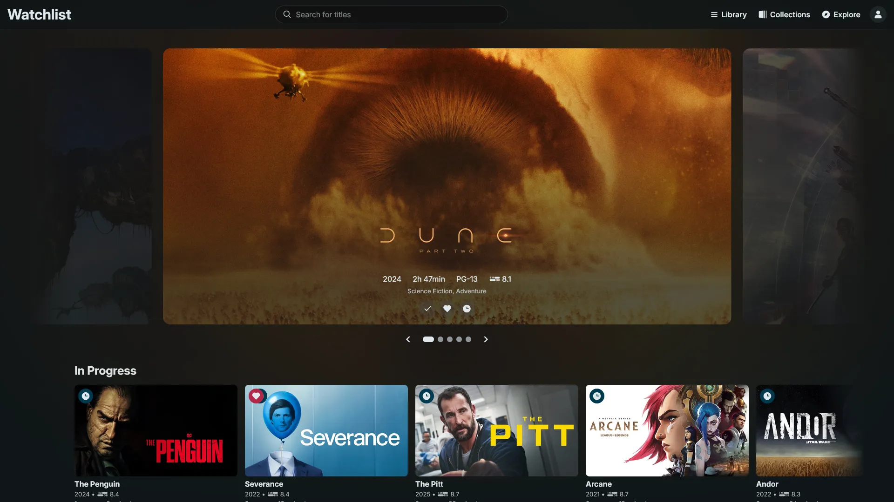
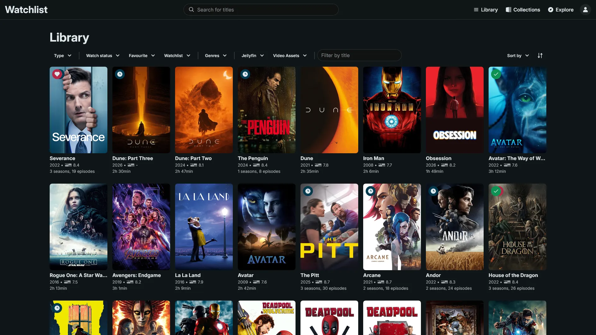
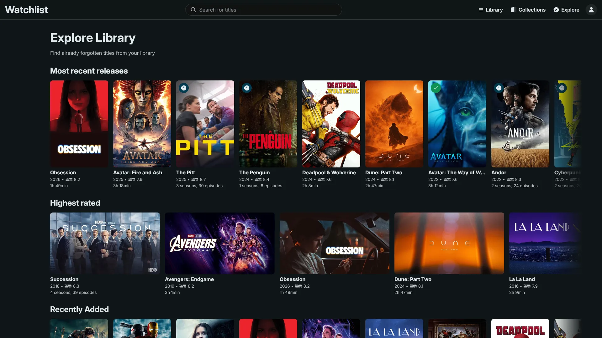
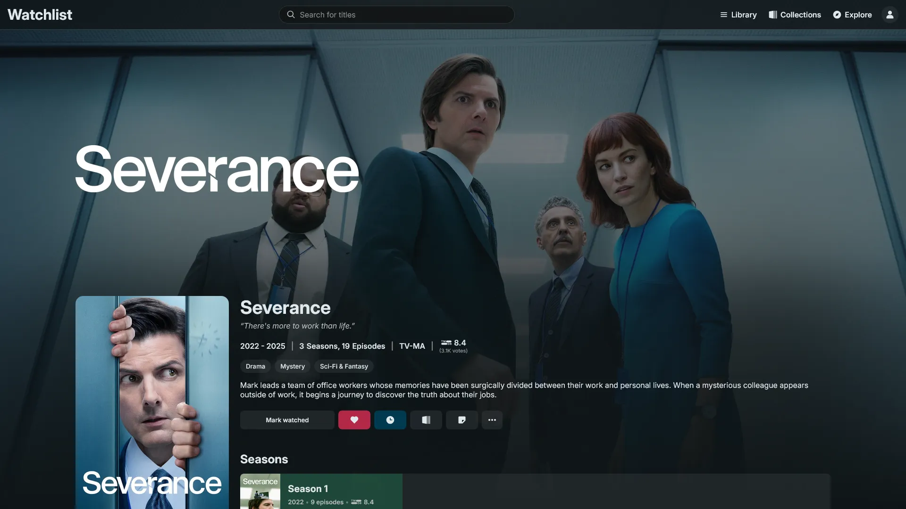
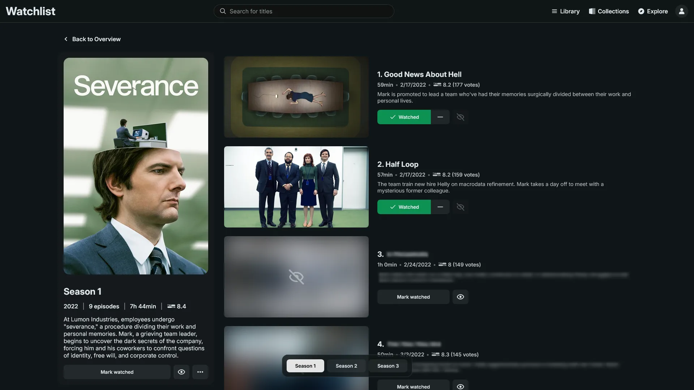

# Screenshots

A visual overview of the application.

## Desktop Views

### Home

### Library

### Explore

### Title details

### Season details

<!-- ---

## Mobile Experience
Watchlist is fully responsive and designed to feel like a native app on mobile devices.

  
  
  

 -->